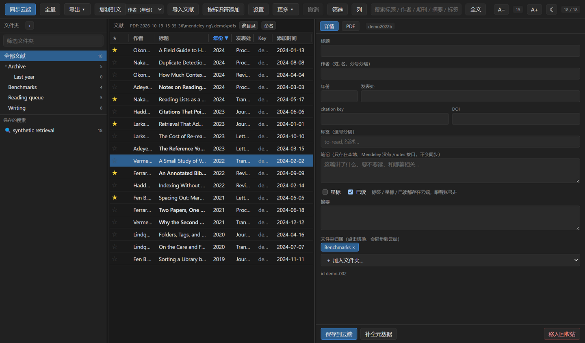
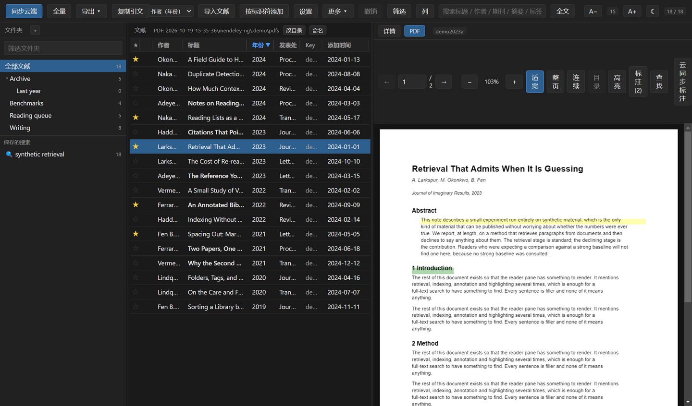
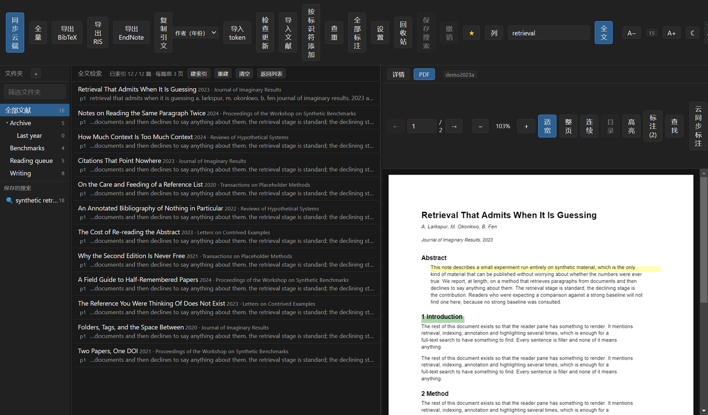
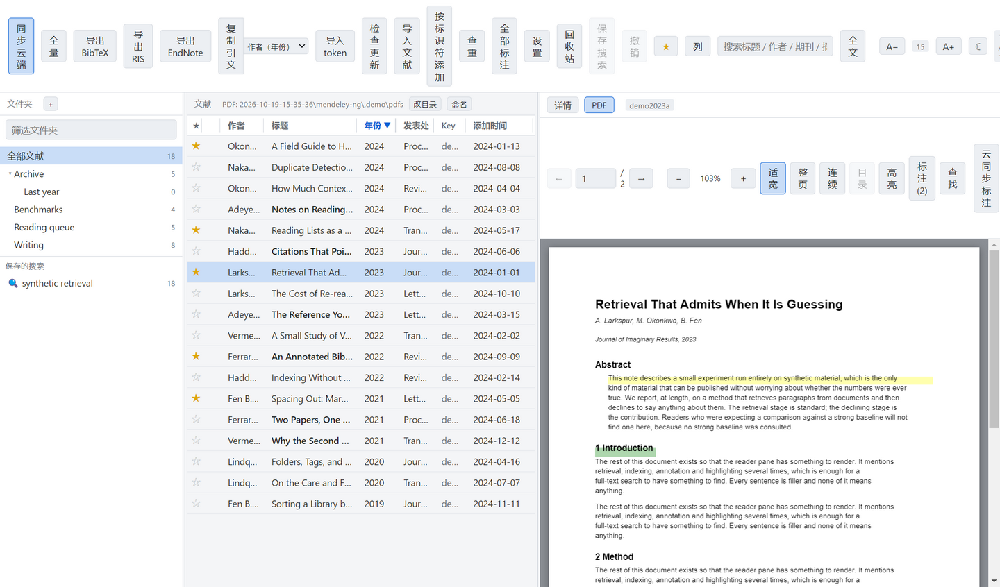

# Mendeley NG

替代 Mendeley Desktop 1.19.8 的文献管理器。Electron + React + pdf.js，直接读写你的
Mendeley 云端库。

> 要接手开发，看 [HANDOFF.md](HANDOFF.md)：现状、架构、API 的坑、待办都在里面。

写它的唯一理由：1.19.8 是 Qt 5.10.1 编译的，它声明自己感知 DPI 但支持不完整，
按物理像素渲染、不吃系统缩放倍率，所以在 4K 屏上字只有别的程序一半大；
改注册表强制 `DPIUNAWARE` 又会换来整窗模糊。Chromium 则是按系统 scale factor
缩放 CSS 像素的，天然就是清晰的，不需要任何 DPI 补丁。

## 界面

下面四张图都截自一份**虚构的库**：标题、作者、DOI、甚至 PDF 本身，都是
`scripts/demo.mjs` 生成出来的，不是任何人的真实文献——截图不该把谁在读什么
贴到公共仓库里。它也不会读到你自己的库：整个演示跑在 `.demo/` 这个独立的
`--user-data-dir` 里，同步被拒掉，索引也建在那里。

想重新生成就跑 `npm run demo`（会覆盖 `docs/screenshots/` 下的四张图）。

**文献列表与详情**——左边文件夹树、中间虚拟滚动的列表、右边元数据面板：
作者、发表处、citation key、DOI、标签、只存本地的笔记，以及文件夹勾选。



**读 PDF**——pdf.js 按 `devicePixelRatio` 出后备缓冲，高 DPI 下不虚；
高亮落在正文上，目录与标注分别在侧栏。



**全文检索**——搜的是 PDF 正文而不是书目字段。命中按篇分组，带页码和上下文，
点一条直接翻到那一页。



**浅色主题**——同一份库，工具栏 ☾ / ☀ 切换，原生滚动条与表单也跟着变。



## 安装与运行

不想自己构建的话，直接下 [Releases](https://github.com/shenyunhang/Mendeley-NG/releases)
里的 `Mendeley-NG-*-Setup.exe`；装好后应用内点**检查更新**就能拉新版、自动安装重启。

```bash
npm install
npm run build      # 产出 out/
npm start          # 启动
npm run dev        # 热重载开发
npm run typecheck  # main/preload 与 renderer 双侧类型检查
npm run dist       # 打包 Windows NSIS 安装包
```

`npm start` 走的是 `scripts/start.mjs` 而不是直接 `electron .`：某些 shell
（Electron 系的 IDE 终端就是）会导出 `ELECTRON_RUN_AS_NODE=1`，带着它启动
electron.exe 会退化成纯 Node，`require('electron')` 返回的是二进制路径字符串，
主进程直接死在 `app.whenReady()`。启动脚本把这个变量剔掉，从哪儿跑都能起来。

## 获取 token（首次使用必读）

Mendeley 的 API 用 OAuth 2.0，而这个项目没有内置 client credential——
**每个人都要注册自己的应用**，所以没有现成的 token 可下载。走一遍就好，之后
refresh token 会自动续期，不用再来第二次。

### 1. 注册应用

打开 <https://dev.mendeley.com/myapps.html> 注册一个应用。Redirect URL 填：

```
http://localhost:8080/
```

注册完会拿到 `client_id` 和 `client_secret`。

### 2. 换 token

```bash
node scripts/get-token.mjs <client_id> <client_secret>
```

脚本会打印一个授权地址。在浏览器里打开、登录后同意授权，浏览器接着会跳到一个
打不开的 `localhost` 地址——**这是正常的**，那个地址根本不需要能访问。
把地址栏里 `?code=` 后面那一段复制下来，粘回命令行。

成功后会在项目根目录写出 `token.json`（已在 `.gitignore` 里，不会被提交）。

<details>
<summary>想手动做的话</summary>

授权地址：

```
https://api.mendeley.com/oauth/authorize?client_id=<ID>&redirect_uri=http://localhost:8080/&response_type=code&scope=all
```

拿到 `code` 后：

```bash
curl -X POST https://api.mendeley.com/oauth/token \
  -A "Mozilla/5.0 (Windows NT 10.0; Win64; x64) AppleWebKit/537.36 (KHTML, like Gecko) Chrome/124.0.0.0 Safari/537.36" \
  -u "<client_id>:<client_secret>" \
  -d "grant_type=authorization_code" \
  -d "code=<CODE>" \
  -d "redirect_uri=http://localhost:8080/"
```

`-A` 不能省：`api.mendeley.com` 前面的 Cloudflare 会对不像浏览器的请求返回
error 1010，`/oauth/token` 也一样。把响应里的 `access_token` / `refresh_token`
连同 `client_id` / `client_secret` 一起存成 `token.json`。

</details>

### 3. 导入

启动应用，点工具栏**导入 token**，选中刚才那个 `token.json`，会自动开始同步。

应用也会在下述位置自动找 token，找到了就不用导入：

- `<userData>/token.json`
- `<userData>/mendeley-token.json`
- 环境变量 `MENDELEY_TOKEN_PATH` 指向的路径

`<userData>` 在 Windows 上是 `%APPDATA%\mendeley-ng`。

### 4. 本地 PDF

默认 PDF 目录是 Mendeley Desktop 自己的 `%LOCALAPPDATA%\Mendeley Ltd\Mendeley Desktop\Downloaded`，
可在中间栏**改目录**更换。文件名按 `作者 - 年份 - 标题.pdf` 解析后与云端条目匹配。

全量同步需要几分钟，取决于库的规模与 Mendeley 那边的响应速度。

## 它能做什么

| 功能 | 说明 |
| --- | --- |
| 同步 | 默认增量（`modified_since`），没改动时 3 秒；「全量」重拉全库，也是发现删除的唯一办法 |
| 浏览 | 三栏：文件夹树 / 文献列表 / 详情或 PDF。列表是虚拟滚动，几千行也不卡 |
| 分栏拖动 | 两条竖边都能拖；双击复位，也能用 ←/→ 微调。宽度会记住，中间列表有最小宽度兜底 |
| 搜索 | Ctrl+F，覆盖标题、作者、发表处、citation key、DOI；工具栏「全文」改成搜 PDF 正文 |
| 保存的搜索 | 把文件夹 + 搜索词 + 星标存成虚拟文件夹，存在本地配置里 |
| 列定制 | 工具栏「列」勾选要显示的列、上下调顺序，可存成命名视图 |
| 列头拖动 | 左右拖列头换顺序，拖列头右缘改宽度（双击复位）。顺序和宽度都会记住 |
| 排序 | 点列头切换升降序（年份 / 标题 / 作者 / 发表处 / Key / 星标 / 添加时间）。拖过列头的那一下不算点，不会顺手把刚挪好的列排一遍序；排序和列布局一样会记住 |
| 文件夹 | 嵌套树：新建、重命名、删除、拖到别的文件夹改父级、拖回顶层 |
| 归文件夹 | 把文献行拖到左侧文件夹即可加入；详情面板可勾选移出 |
| 全文检索 | 「全文」模式下搜 PDF 正文，命中按篇分组、显示页码与上下文，点一条直接翻到那页 |
| 读 PDF | pdf.js，按 `devicePixelRatio` 出后备缓冲，高 DPI 下不虚；点进阅读区后 PageUp/PageDown/空格/←→/Home/End 翻页 |
| 篇内查找 | Ctrl+F 或「查找」在当前 PDF 里找词，命中处标橙、显示 n/N，回车跳下一个 |
| 复制引文 | 工具栏「复制引文」或 Ctrl+Shift+C，六种样式（作者（年份）/ 全作者 / 编号 / 完整条目 / BibTeX key / BibTeX 条目） |
| 连续滚动 | 「连续」把所有页排成一列滚着读；单页模式下预取相邻页，翻页不等 |
| 高亮 | 选中文字即高亮，可改色、加笔记、删除 |
| 缩放 | 适宽 / 整页，跟着窗口变；手动缩放后不再被覆盖 |
| PDF 目录 | 读 PDF 自带的 outline，点击跳到对应页 |
| 标注侧栏 | 列出本篇全部标注，点一条跳到那一页并选中 |
| 全部标注 | 跨篇列出整个库的标注，按篇分组，点一条选中那篇并翻到那一页 |
| 标注同步 | 高亮推到 Mendeley `/annotations`，也能把云端的拉回来 |
| 补 PDF | 云端有附件但本地没有的，一键下载到本地 PDF 目录 |
| 导入 PDF | 把 PDF 拖进窗口就建条目，元数据交给服务端从文件里抽 |
| 导入书目 | BibTeX / RIS / EndNote XML，先预览再导入，已有的标为重复 |
| 改元数据 | 右侧详情面板直接编辑，PATCH 回 Mendeley 云端 |
| 标记 | 星标 / 已读 / 标签，点一下就写回云端；工具栏 ★ 只看星标，未读加粗 |
| 笔记 | 每篇一条，**只存本地**：Mendeley 没有 /notes 接口，界面里写明了不同步 |
| 批量 | Shift 选范围、Ctrl 加减选、Ctrl+A 选中当前结果全部、Esc 取消多选；批量加入文件夹 / 改字段（加标签、改类型、设星标已读）/ 移入回收站 / 导出 |
| 行右键菜单 | 复制引文 / 复制标题 / 加星 / 标已读 / 在文件夹中显示 / 用系统程序打开 / 移入回收站 |
| 键盘导航 | ↑↓ 选行、Home/End 到首尾、Enter 打开、Delete 入回收站、Ctrl+A 选中当前结果、Esc 关浮层/取消多选；焦点在输入框里时不抢键（Ctrl+A 仍是选中框里的字） |
| 撤销 | Ctrl+Z 或工具栏「撤销」：覆盖删除、合并、批量加文件夹、批量改字段 |
| 安装包签名 | CI 已接好，配上证书即签名；`npm run signcheck` 可自查是否签上 |
| 补全元数据 | 查 Crossref 与 arXiv，列出候选让你挑，不自动覆盖 |
| 按标识符添加 | 粘 DOI / arXiv id / 标题，查到后确认再建条目，不需要 PDF |
| 查重合并 | 按 DOI / arXiv id / 标题找重复；合并只补缺失字段 |
| 回收站 | 移入回收站、恢复、彻底删除 |
| 导出 | BibTeX / RIS / EndNote XML，可只导出当前筛选结果或单条；弹保存对话框自己选位置，记住上次目录 |
| 检查更新 | 一键从 GitHub Releases 拉新版、下载、安装并重启 |
| 字号 | 工具栏 A−/A+，或 Ctrl+− / Ctrl+=。整站 rem，一个旋钮全跟着变 |
| 主题 | 深 / 浅两色，工具栏 ☾ / ☀ 切换，会记住；原生滚动条与表单也跟着变 |
| 设置 | 工具栏「设置」：主题、字号、PDF 目录、命名模板、引文样式、全文索引页数集中在一处 |
| 打开 PDF 位置 | 「在文件夹中显示」调文件管理器，「用系统程序打开」走系统默认 PDF 阅读器 |

两处值得单独说的设计取舍：

- **补全元数据宁缺勿错**。标题相似度阈值 0.90，短标题还额外关掉"子串包含"的
  兜底。"Object detection" 对 "Lifelong Object Detection" 得分 0.78，是两篇不同的
  文章，必须拒掉；查不到顶多是少补几个字段，查错了会污染引用。
- **全文检索默认只索引每篇的前 3 页**。全库 5245 份 PDF 全量抽正文约 293 MB 文本、
  每份 130 ms；前 3 页约 60 MB、每份 39 ms。前者在内存里放不下，后者可以，
  而标题、作者、摘要和引言开头基本覆盖了会去搜的词。这个取舍写在界面上，不藏着，
  页数也能在「设置」里改——改了会丢索引，因为它描述的已经是另一份语料了。
- **合并只补缺失字段，落败的进回收站而不是删掉**。合并是不可逆操作里最容易
  手滑的，让它可恢复比让它快更重要——现在还有撤销栈兜底。

还没做的：无。
原因和优先级都在 [HANDOFF.md](HANDOFF.md) 第 8 节。

## 结构

```
electron/main/mendeley.ts   Mendeley REST 客户端
electron/main/store.ts      本地缓存：文献、文件夹、标注、配置
electron/main/pdfindex.ts   把 "作者 - 年份 - 标题.pdf" 匹配回文献
electron/main/lookup.ts     Crossref / arXiv 元数据查询
electron/main/updater.ts    electron-updater 自更新
electron/main/index.ts      主进程，IPC，mendeley:// 协议，--smoke 自检
electron/preload/index.ts   contextBridge，只暴露白名单方法
src/                        renderer：React + 虚拟滚动 + pdf.js 文本层
src/lib/dupes.ts            查重分组与保留哪一条的取舍
src/lib/import.ts           BibTeX / RIS / EndNote XML 解析
src/lib/export.ts           BibTeX / RIS / EndNote XML 生成
src/lib/pdfmeta.ts          从 PDF 前两页抽 DOI / arXiv id
shared/types.ts             三端共享的类型
shared/text.ts              标题归一化与相似度（查源与查重共用）
scripts/start.mjs           启动器
scripts/get-token.mjs       OAuth 授权码流程，产出 token.json
scripts/check-api.mjs       API 冒烟测试（不启 GUI）
```

几个约定：类型不要三处各写一份，改 `shared/`；所有尺寸用 rem，字号旋钮才有效；
主进程产物必须是 CJS，package.json 里不能有 `"type": "module"`；
`contextIsolation: true`，renderer 拿不到 node，所有能力走 `window.api`。

## 发布

安装包**不进 git**（二进制会让仓库无谓膨胀），走 GitHub Release 分发。

### 自动（推荐）

`.github/workflows/release.yml` 会在推送 `v*` tag 时用 GitHub 的 Windows runner 编译并把 exe 挂到 Release：

```bash
git tag v0.1.0 && git push origin v0.1.0
```

公开仓库的标准 runner 免费、不限分钟，产物存储也免费。

**版本号要先改 `package.json` 的 `version` 再打 tag**，两者需一致——安装包文件名和
`latest.yml` 都取自它，不一致会让客户端的自更新判断错乱。

Release 附件必须同时包含**安装包和 `latest.yml`**：后者是 `electron-updater` 用来
发现新版本的清单，漏了它客户端点了更新也找不到东西。CI 已经处理，手动发布时别忘。

### 手动

不想配 CI 的话，本地 `npm run dist`，然后到仓库页 Releases → Create a new release，
把 `dist/Mendeley-NG-<版本>-Setup.exe` 拖进去发布。

也可以在 Actions 页面手动触发上面那个 workflow（不推 tag 也行），
产物会作为 30 天有效期的 artifact 上传，不会创建 Release。

### 代码签名（消除 SmartScreen 警告）

未签名的安装包在 Windows 上每次安装都会弹 SmartScreen 的"未知发布者"，
需要点两次"更多信息 → 仍要运行"才能装。消除它只有一个办法：**用代码签名证书签名**，
没有别的取巧途径。

本仓库的 CI 已经接好了，只是默认没有证书所以不签。要启用：

1. 买一张 Windows 代码签名证书（OV 即可，IV 会更快建立声誉；
   各 CA 价格差异很大，属个人开支）。拿到 `.pfx`/`.p12` 和它的密码。
2. 把 pfx 转成 base64 单行文本：
   ```bash
   base64 -w0 cert.pfx > cert.b64      # Linux / Git Bash
   certutil -encode cert.pfx cert.b64  # Windows cmd
   ```
3. 到仓库 Settings → Secrets and variables → Actions 建两个 secret：
   - `CSC_LINK` = 上面那串 base64
   - `CSC_KEY_PASSWORD` = pfx 的密码

`electron-builder` 读到这两个环境变量就会自动签名，读不到就**静默跳过**——
安装包照样能编出来、照样能跑，看不出区别。所以 CI 多了一步
`npm run signcheck`，直接问 Windows 拿签名状态：没有证书时只警告，
有证书却没签上则直接判失败。本地也能跑 `npm run signcheck` 自查。

新证书的声誉要下载量积累一段时间才会完全消失提示，这是 SmartScreen 的机制，不是配置问题。

## 提交即推送（可选）

仓库里带了一个 `post-commit` 钩子，提交完自动推到远端，任务做完不用再记得 `git push`：

```bash
cp scripts/hooks/post-commit .git/hooks/post-commit && chmod +x .git/hooks/post-commit
```

`.git/hooks` 不进版本库，所以每次 clone 后要装一次。临时不想推就 `GIT_AUTO_PUSH=0 git commit ...`。

## 开发用的自检

```bash
npm run smoke              # 全流程：拉库 → 渲染窗口 → 点第一行 → 出两张截图
npm run smoke -- --no-sync # 用本地缓存，跳过同步
```

`--smoke` 会跑完整同步、开一个隐藏窗口、点第一行有 PDF 的文献、等渲染完成后用
`capturePage` 截图，存到系统临时目录 `mendeley-ng-smoke.png` /
`mendeley-ng-smoke-pdf.png`。日志里会打出 `scaleFactor`、`devicePixelRatio`、
canvas 的后备尺寸与 CSS 尺寸（后者应该是前者的 `1/dpr`），这是验证高 DPI 是否
真的生效的唯一可靠办法。

它还会造一次合成选区，验证文本层能选出文字并算出正确的矩形，然后把
`annotations.json` **按文件快照**恢复回去——自检不能动真实数据。

```bash
npm run demo   # 造一份虚构的库，截取 README 里的四张图
```

`--demo` 与自检同源，但方向相反：自检要真实数据才测得准，截图要假数据才敢公开。
它用 `--user-data-dir=.demo` 把缓存、配置和全文索引都关在 `.demo/` 里，
`library:sync` 直接返回本地缓存、不联网，索引是当场建的（十八份两页的 PDF，
几秒钟）。

## 踩过的坑

- **`GET /documents` 默认 view 不返回 `citation_key` / `file_attached` / `folder_uuids`**，
  必须带 `?view=all`。
- **Cloudflare error 1010**：`api.mendeley.com` 会拦没有浏览器 UA 的请求，
  连 `/oauth/token` 也拦，所有请求都要带 Chrome UA。
- **`POST /folders` 必须用 `application/vnd.mendeley-folder.1+json`**，
  用默认的 document content-type 会 415。
- **`POST /folders/{id}/documents` 的 body 是 `{"id": did}`**，不是 `document_id`。
- **`DELETE /folders/{id}/documents/{did}`** 成功返回 204；目标本就不在该文件夹时返回 409，
  重复调用会 500。
- **本地库是 SQLCipher 加密的**，文件头不是 `SQLite format 3`，读不了，
  元数据只能走云端 API。1.19.8 自己存在库里的凭据同理取不出来。
- **标注坐标是绝对 PDF 点，而 `top_left` 存的是 y 更小的那个点**，也就是视觉上的
  **左下角**（PDF 用户空间原点在左下）。视觉顶部 = `pageHeight - max(y)`。
  另外 `POST /annotations` 缺 `filehash` 会被静默降级成普通 note 并丢掉 positions。
- **上传文件既不是 JSON 也不是 multipart**：`POST /documents` 带 PDF 裸字节 + 两个头
  （`Content-Type: application/pdf`、`Content-Disposition: attachment; filename="..."`），
  一次建条目并自动附件。multipart 会被拒，且报错是误导性的
  "'Content-Disposition' header is required"。服务端还会自己从 PDF 抽元数据，
  所以别用文件名回填标题，会把抽好的覆盖掉。
- **`doi` / `arxiv` 写在顶层是无效的**（返回 200 但不落库），真字段是 `identifiers`。
- **彻底删除要 `DELETE /trash/{id}`**；`DELETE /documents/{id}` 对已回收的条目是 404。
- **`GET /files/{id}` 不返回字节**，是 303 到 S3 预签名地址，跳过去时别带 Authorization。
- **主进程产物不能是 ESM**：package.json 里不要写 `"type": "module"`，
  否则 `require('electron')` 的 CJS 互操作会挂。
- **`app.quit()` 不接受参数**，要带退出码用 `app.exit(code)`。
