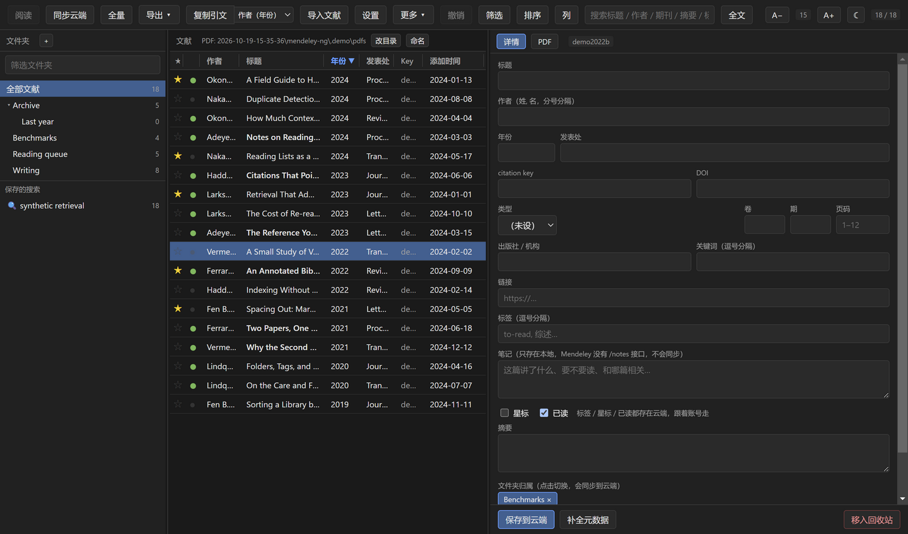
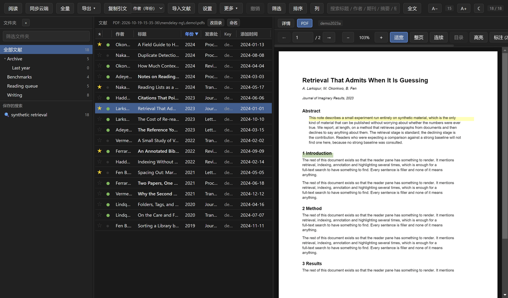
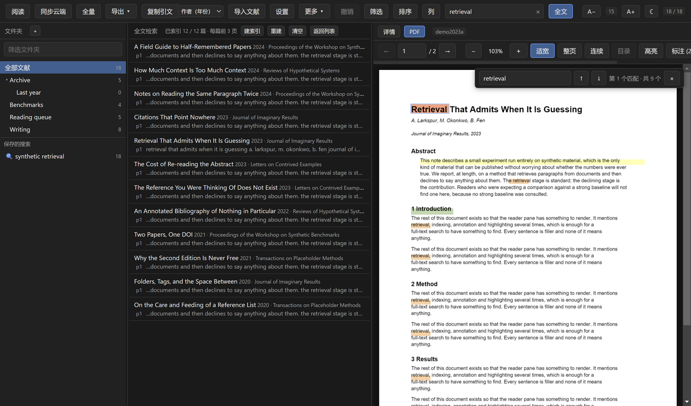
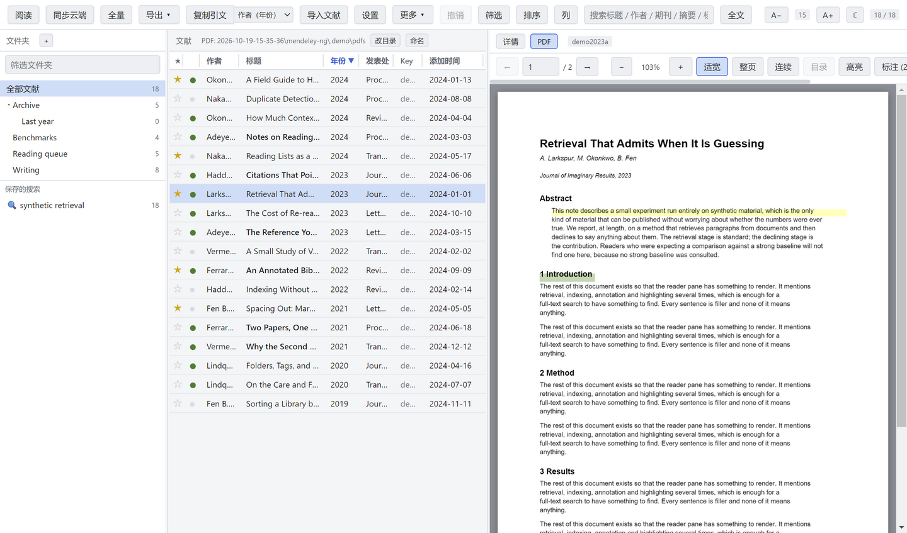

# Mendeley NG

**本地优先的 Mendeley 客户端。** 文献、PDF、正文索引、高亮和笔记都落在你自己的
磁盘上，读和搜都不需要联网。Electron + React + pdf.js。

> 要接手开发，看 [HANDOFF.md](HANDOFF.md)：现状、架构、API 的坑、按编号排的改动历史都在里面。

## 它为什么存在

你的库存在 Elsevier 的服务器上，而**能完整打开它的那个桌面客户端正在被冻结**：

- Mendeley Desktop 停在 1.19.8。官方 2025 年 7 月写明它「不会再有新功能开发」，
  只保留关键安全维护，并且「不保证与未来操作系统的兼容性」；
- 更早的安排是彻底停止 1.19.8 的登录，官方暂时收回了这个决定，但长期计划仍在；
- 官方指定的接班人是 Mendeley Reference Manager——另一个产品，账号与云端优先，
  与 1.19.8 并不是同一套用法。

NG 不替代其中任何一个，它换掉的是**依赖关系**：云端是同步源，不是宿主。
同步下来的东西全部落在本地——文献、PDF、正文索引、高亮、笔记——
所以读、搜、标注、导出都不经过网络，也不取决于哪个客户端还活着。

仍然需要联网的只有三件事：同步条目、下载 PDF、把高亮推回 `/annotations`。
这一点不粉饰：**它让你不必依赖 Mendeley 的客户端，但暂时仍要依赖它的 API。**

这个依赖断掉时会发生什么，也一并说在前面：**API 关掉、token 过期，或者只是断了网，
屏幕上的库都照常能用**——它是磁盘上的一份，不是每次打开都要去取一次的。这时不工作的
只有同步和下载 PDF 两件，「带走整个库…」也仍然完整可用（它做的全是本地文件的拷贝）。
同步失败时那条提示会分清是哪一种、你能做什么，不会一律让你去补 token。

所以离开的路也是做好了的：**「导出 → 带走整个库…」**一次把书目（BibTeX / RIS /
EndNote XML）、笔记、标注和 PDF 写进一个文件夹，附一份说明。其中笔记和高亮
**没有通用导入格式**，那上面写明了——它们只存在本机，也正因如此必须能带走。

### 为什么不是 1.19.8

1.19.8 是 Qt 5.10.1 编译的，它向系统声明自己感知 DPI 但支持不完整——
按物理像素渲染、不吃系统缩放倍率，所以在 4K 屏上字只有别的程序一半大；
改注册表强制 `DPIUNAWARE` 又会换来整窗模糊。Chromium 则是按系统 scale factor
缩放 CSS 像素的，天然就是清晰的，不需要任何 DPI 补丁。

这是"为什么不用旧的"，不是"为什么用这个"。前者只是后者碰巧也解决了的一条症状。

## 界面

下面四张图都截自一份**虚构的库**：标题、作者、DOI、甚至 PDF 本身，都是
`scripts/demo.mjs` 生成出来的，不是任何人的真实文献——截图不该把谁在读什么
贴到公共仓库里。它也不会读到你自己的库：整个演示跑在 `.demo/` 这个独立的
`--user-data-dir` 里，同步被拒掉，索引也建在那里。

想重新生成就跑 `npm run demo`（会覆盖 `docs/screenshots/` 下的四张图）。

**文献列表与详情**——左边文件夹树、中间虚拟滚动的列表、右边元数据面板：
作者、发表处、citation key、DOI、标签、只存本地的笔记，以及文件夹勾选。



**读 PDF**——pdf.js 按 `devicePixelRatio` 出后备缓冲，高 DPI 下不虚；
高亮落在正文上，目录与标注分别在侧栏。



**全文检索**——搜的是 PDF 正文而不是书目字段。命中按篇分组，带页码和上下文，
点一条直接翻到那一页。



**浅色主题**——同一份库，工具栏 ☾ / ☀ 切换，原生滚动条与表单也跟着变。



## 安装与运行

不想自己构建的话，直接下 [Releases](https://github.com/shenyunhang/Mendeley-NG/releases)
里的 `Mendeley-NG-*-Setup.exe`；装好后应用内点**检查更新**就能拉新版、自动安装重启。

```bash
npm install
npm run build      # 产出 out/
npm start          # 启动
npm run dev        # 热重载开发
npm run typecheck  # main/preload 与 renderer 双侧类型检查
npm run dist       # 打包 Windows NSIS 安装包
```

`npm start` 走的是 `scripts/start.mjs` 而不是直接 `electron .`：某些 shell
（Electron 系的 IDE 终端就是）会导出 `ELECTRON_RUN_AS_NODE=1`，带着它启动
electron.exe 会退化成纯 Node，`require('electron')` 返回的是二进制路径字符串，
主进程直接死在 `app.whenReady()`。启动脚本把这个变量剔掉，从哪儿跑都能起来。

## 获取 token（首次使用必读）

**这一步只做一次，大约两分钟。** 做完 token 会自己续期，你不用再来第二次，
也不用再碰 dev.mendeley.com。

Mendeley 的 API 用 OAuth 2.0，而这个项目没有内置 client credential——
**每个人都要注册自己的应用**，所以没有现成的 token 可下载。
**这不是注册开发者账号，也不用写任何代码**：页面上只有两个框要填，
填完它给你两串字符，粘进应用就行。

<details>
<summary>为什么非要这一步（技术上绕不开）</summary>

Mendeley 的 OAuth **没有 PKCE**，code flow 因此必须带 `client_secret`；
implicit flow 官方写明不返回 refresh token、也不给过期时间，而 access token
约一小时就失效——用它等于每小时重新授权一次，比这一步更糟。

</details>

### 1. 注册应用

打开 <https://dev.mendeley.com/myapps.html> 注册一个应用。Redirect URL 填：

```
http://localhost:8080/
```

注册完会拿到 `client_id` 和 `client_secret`。

### 2. 接入

把 `client_id` 和 `client_secret` 填进应用首屏那两个框，点**授权并接入**。
会弹一个窗口让你登录并同意，同意完就好了——token 会自动写进应用自己找的那个
位置，并开始同步。不用碰命令行，也不用去手抄任何东西。

<details>
<summary>不想把 client_secret 粘进输入框</summary>

也可以走命令行：

```bash
node scripts/get-token.mjs <client_id> <client_secret>
```

脚本会打印一个授权地址。在浏览器里打开、登录后同意授权，浏览器接着会跳到一个
打不开的 `localhost` 地址——**这是正常的**，那个地址根本不需要能访问。
把地址栏里 `?code=` 后面那一段复制下来，粘回命令行。

成功后会在项目根目录写出 `token.json`（已在 `.gitignore` 里，不会被提交），
用首屏**选择已有的 token.json** 选中它即可。

</details>

<details>
<summary>想手动做的话</summary>

授权地址：

```
https://api.mendeley.com/oauth/authorize?client_id=<ID>&redirect_uri=http://localhost:8080/&response_type=code&scope=all
```

拿到 `code` 后：

```bash
curl -X POST https://api.mendeley.com/oauth/token \
  -A "Mozilla/5.0 (Windows NT 10.0; Win64; x64) AppleWebKit/537.36 (KHTML, like Gecko) Chrome/124.0.0.0 Safari/537.36" \
  -u "<client_id>:<client_secret>" \
  -d "grant_type=authorization_code" \
  -d "code=<CODE>" \
  -d "redirect_uri=http://localhost:8080/"
```

`-A` 不能省：`api.mendeley.com` 前面的 Cloudflare 会对不像浏览器的请求返回
error 1010，`/oauth/token` 也一样。把响应里的 `access_token` / `refresh_token`
连同 `client_id` / `client_secret` 一起存成 `token.json`。

</details>

### 3. token 放在哪

不用手动找：应用自己会在下述位置找 token，找到就直接用：

- `<userData>/token.json`
- `<userData>/mendeley-token.json`
- 环境变量 `MENDELEY_TOKEN_PATH` 指向的路径

`<userData>` 在 Windows 上是 `%APPDATA%\mendeley-ng`。

### 4. 本地 PDF

默认 PDF 目录是 Mendeley Desktop 自己的 `%LOCALAPPDATA%\Mendeley Ltd\Mendeley Desktop\Downloaded`，
可在中间栏**改目录**更换。文件名按 `作者 - 年份 - 标题.pdf` 解析后与云端条目匹配。

全量同步需要几分钟，取决于库的规模与 Mendeley 那边的响应速度。

## 它能做什么

按**三件事**排，不按功能清单排。判据是"离网能不能做"：读和找全部离网可用，
所以它们是主角；守要联网，所以它是把东西搬到本地的**手段**。

### 读（离网可用）

| 功能 | 说明 |
| --- | --- |
| 读 PDF | pdf.js，按 `devicePixelRatio` 出后备缓冲，高 DPI 下不虚；点进阅读区后 PageUp/PageDown/空格/←→/Home/End 翻页 |
| 篇内查找 | Ctrl+F 在当前 PDF 里找词，命中标橙、显示 n/N，回车跳下一个 |
| 页内链接 | PDF 自带的超链接可点：内部章节跳转翻页，外部地址交给浏览器。**默认不画框**——一篇几十个链接，满屏蓝框让每句话都像能点——悬停才显形；开着拖选高亮时整层让位 |
| 参考文献跳转 | 悬停正文里的引用标记看那条参考文献；在库里的给「打开」，PDF 里指向库内论文的链接也在这里开。**打开时左侧文件夹树定位到它所属的文件夹**，列表筛选和树高亮始终是同一个状态 |
| 连续滚动 | 把所有页排成一列滚着读；单页模式下预取相邻页，翻页不等 |
| 缩放 | 适宽 / 整页，跟着窗口变；手动缩放后不再被覆盖 |
| 高亮 | 选中文字即高亮，可改色、加笔记、删除；**划下来的那句话会一并存下**——只有矩形的高亮换个地方就没法读了 |
| PDF 目录 | 读 PDF 自带的 outline，点击跳到对应页 |
| 标注侧栏 | 列出本篇全部标注，点一条跳到那一页并选中 |
| 全部标注 | 跨篇列出整个库的标注，按篇分组，点一条选中那篇并翻到那一页 |
| 笔记 | 每篇一条，**只存本地**：Mendeley 没有 /notes 接口，界面里写明了不同步 |
| 笔记导出 | 「导出 → 笔记（Markdown）」：只带走了写过的那些篇，标题 + 作者 / 年份 / 发表处 / citation key / DOI + 正文 |
| 标注导出 | 「导出 → 标注（Markdown）」：按篇分组、组内按页码，每条是引用下的那句话加页码和批注。**已经不在库里的那篇的标注也会一起出来**——它们没有别的出口 |
| 打开 PDF 位置 | 「在文件夹中显示」调文件管理器，「用系统程序打开」走系统默认 PDF 阅读器 |

### 找（离网可用）

| 功能 | 说明 |
| --- | --- |
| 浏览 | 三栏：文件夹树 / 文献列表 / 详情或 PDF。列表是虚拟滚动，几千行也不卡；**单实例**：再点一次图标只会把已经开着的那个窗口叫回来 |
| 搜索 | Ctrl+F，覆盖标题、作者、发表处、citation key、DOI、摘要、标签，以及这篇上写的本地笔记 |
| 全文检索 | 「全文」模式下搜 PDF 正文，命中按篇分组、显示页码与上下文，点一条直接翻到那页；**搜不到时会说清读了多少页、以及这不等于库里没有**，并给出改页数的入口 |
| 筛选 | 按星标 / 未读 / 没有本地 PDF / 云端有本地没有 / 未归文件夹收窄，每档带条数 |
| 排序 | 点列头切换升降序（年份 / 标题 / 作者 / 发表处 / Key / 星标 / 添加时间）。拖过列头的那一下不算点，不会顺手把刚挪好的列排一遍序；排序和列布局一样会记住 |
| 列定制 | 「列」勾选要显示的列、上下调顺序，可存成命名视图 |
| 列头拖动 | 左右拖列头换顺序，拖列头右缘改宽度（双击复位）。顺序和宽度都会记住 |
| 文件夹 | 嵌套树：新建、重命名、删除、拖到别的文件夹改父级、拖回顶层 |
| 归文件夹 | 把文献行拖到左侧文件夹即可加入；详情面板可勾选移出 |
| 保存的搜索 | 把文件夹 + 搜索词 + 星标存成虚拟文件夹，存在本地配置里 |
| 标记 | 星标 / 已读 / 标签；未读加粗 |
| 分栏拖动 | 两条竖边都能拖；双击复位，也能用 ←/→ 微调。宽度会记住，中间列表有最小宽度兜底 |
| 行右键菜单 | 复制引文 / 复制标题 / 加星 / 标已读 / 在文件夹中显示 / 用系统程序打开 / 移入回收站 |
| 键盘导航 | ↑↓ 选行、Home/End 到首尾、Enter 打开、Delete 入回收站、Ctrl+A 选中当前结果、Esc 关浮层/取消多选、点列表空白处取消选择；焦点在输入框里时不抢键 |

### 守（要联网，是手段不是目的）

| 功能 | 说明 |
| --- | --- |
| 同步 | 默认增量（`modified_since`），没改动时 3 秒；**打开软件时自动同步一次**（默认开，可在设置里关，静默失败不弹红）；每次同步都对账云端回收站与 `/files` 全部分页；点「同步云端」「全量」之后会把「云端有、本地没有」的 PDF 一起后台下载（三路并发、可随时停止，设置里可关）；启动时的静默同步不下载。「全量」重拉全库，是字段整体校准的手段 |
| 导入 token | 首次使用必读，步骤见上文的「获取 token」 |
| 补 PDF | 云端有附件但本地没有的，一键下载到本地 PDF 目录；同步时也可以自动补，见上 |
| 导入 PDF | 把 PDF 拖进窗口就建条目，元数据交给服务端从文件里抽 |
| 导入 | 「导入」下两条：读一个 BibTeX / RIS / EndNote XML 文件（先预览，已有的标为重复），或按 DOI / arXiv id / 标题添加——**后者不需要 PDF** |
| 改元数据 | 右侧详情面板直接编辑，PATCH 回 Mendeley 云端；同一面板只读显示 Mendeley 记录的**加入时间**（悬停看完整时间戳），与列表「添加时间」列是同一份规则 |
| 标注同步 | 高亮推到 Mendeley `/annotations`，也能把云端的拉回来；**启动时**跟着文献同步后台补一次，只处理本地已有标注的论文、只上传已有 PDF 点坐标的高亮，不扫全库也不阻塞界面 |
| 导出 | 「导出」下 BibTeX / RIS / EndNote XML 三档，可只导出当前筛选结果或单条；弹保存对话框自己选位置，记住上次目录 |
| **带走整个库** | 「导出 → 带走整个库…」：书目三种格式 + 笔记 + 标注 + PDF，**一次写进一个文件夹**，附一份说明哪个文件是什么。**笔记和高亮没有通用导入格式，那上面写明了**——别等旧库没了才发现 |
| 复制引文 | 六种样式（作者（年份）/ 全作者 / 编号 / 完整条目 / BibTeX key / BibTeX 条目），Ctrl+Shift+C |
| 检查更新 | 一键从 GitHub Releases 拉新版、下载、安装并重启 |
| 安装包签名 | CI 已接好，配上证书即签名；`npm run signcheck` 可自查是否签上 |

### 附带（保留，但不占工具栏主位）

| 功能 | 说明 |
| --- | --- |
| 查重合并 | 按 DOI / arXiv id / 标题找重复；合并只补缺失字段，落败的进回收站而不是删掉 |
| 批量 | Shift 选范围、Ctrl 加减选、Ctrl+A 选中当前结果全部、Esc 取消多选、点列表空白处清空选择；批量加入文件夹 / 改字段 / 移入回收站 / 导出 |
| 回收站 | 移入回收站、恢复、彻底删除 |
| 补全元数据 | 查 Crossref 与 arXiv，列出候选让你挑，不自动覆盖 |
| 撤销 | Ctrl+Z：覆盖删除、合并、批量加文件夹、批量改字段 |

### 应用本身

| 功能 | 说明 |
| --- | --- |
| 字号 | A−/A+，或 Ctrl+− / Ctrl+=。整站 rem，一个旋钮全跟着变 |
| 主题 | 深 / 浅两色，☾ / ☀ 切换，会记住；原生滚动条与表单也跟着变 |
| 设置 | 主题、字号、PDF 目录、命名模板、引文样式、全文索引页数集中在一处 |
| 工具栏 | 恒为一行，按钮不挤不折行；不常用的命令收在「更多」里 |
| 图标 | Mendeley 官方图形标记（三个圆点 + 两个上瓣 + 中央圆孔），换成 NG 的紫→青渐变；`npm run icon` 从 `scripts/make-icon.mjs` 里的一份多边形环表生成 SVG / ICO / 两种 PNG |

三处值得单独说的设计取舍：

- **补全元数据宁缺勿错**。标题相似度阈值 0.90，短标题还额外关掉"子串包含"的
  兜底。"Object detection" 对 "Lifelong Object Detection" 得分 0.78，是两篇不同的
  文章，必须拒掉；查不到顶多是少补几个字段，查错了会污染引用。
- **全文检索默认只索引每篇的前 3 页**。全库 5245 份 PDF 全量抽正文约 293 MB 文本、
  每份 130 ms；前 3 页约 60 MB、每份 39 ms。前者在内存里放不下，后者可以，
  而标题、作者、摘要和引言开头基本覆盖了会去搜的词。这个取舍写在界面上，不藏着，
  页数也能在「设置」里改——改了会丢索引，因为它描述的已经是另一份语料了。
  页数的边界与默认值**只有一份规则**：设置面板、索引构建和开机时的配置恢复共用它，
  不会出现界面说 3 页、索引却按 50 页建这种对不上的情况。
- **合并只补缺失字段，落败的进回收站而不是删掉**。合并是不可逆操作里最容易
  手滑的，让它可恢复比让它快更重要——现在还有撤销栈兜底。

还没做的：无已坐实的缺陷，也没有在飞的排期。按编号排的改动历史在
[HANDOFF.md](HANDOFF.md) 第 10 节；第 9 节留着的是竞品对照快照、"差距可以接受"、
"明确不做"那几条，以及已经清空的两张代码审查排期表（9.7 / 9.8）。
这里刻意不写编号和断言数——它们每轮都变，唯一事实源是 HANDOFF 第 0 节。

## 结构

```
electron/main/          主进程：IPC、本地库、全文索引、自更新
  index.ts              入口：一个窗口、是不是第二个实例、这次是哪一种启动
  library.ts            云端同步（增量水印、PDF 挂载、缓存合并）
  fulltext.ts / ftops.ts 正文索引与它的驱动层
  store.ts / pdfindex.ts 本地缓存与 "作者 - 年份 - 标题.pdf" 匹配
  mendeley.ts / lookup.ts Mendeley REST 客户端、Crossref / arXiv 查元数据
  window.ts / updater.ts / instance.ts  窗口记忆、检查更新、单实例锁
  ipc/                  按域拆开的 IPC 注册
  smoke.ts / perf.ts / demo.ts  开发期自检、性能测量、虚构库截图
electron/preload/index.ts  contextBridge，只暴露白名单方法
src/App.tsx              组装层：把 hooks 解构出来排进 JSX，不持有大块状态
src/components/           视图组件（PdfViewer.tsx 是阅读器，其余见目录）
src/lib/hooks/            React 状态簇，按「谁跟谁一起变」切
  useConfig / useLibrary / useFullText / useUndo / useSelection / usePaneWidths
  useExport / useFlashMessage / useCiteCard
  useContinuousPages / usePdfFind / usePdfAnnotations / usePdfLinks / usePdfRefs
src/lib/                  与 React 无关的纯规则，主进程冒烟能直接 import 来测
  flash.ts              一条短消息只留一个待触发的清除（151 / 156）
  latestSearch.ts       只答当前那一个词，时钟与请求可注入（152）
  documentScope.ts / findScan.ts / lazyPages.ts  按文献 / 按词 / 按页给答案贴标签（153–155）
  pageWalk.ts           连续模式一屏一次写入的页遍历，末页不丢批（162 / 167）
  bitmapPixelSize.ts    页 canvas 的背板像素尺寸与 dpr 兜底，四处共用（169）
  cardSpot.ts           固定卡片定位与窗口变窄后的重测（159 / 160）
  timing.ts             二十二处延时与短消息时长的具名常量（164 / 168）
  pdfgeom.ts / pdfcache.ts / pdftext.ts / pdffind.ts / pdfsel.ts
                        PDF 坐标换算、位图缓存、文本层、篇内查找、选区
  columns.ts / panes.ts / cite.ts / offline.ts / export.ts / import.ts
                        列定义、三栏、引文格式、离线文案、导入导出
  refly.ts / dupes.ts / pdfmeta.ts / pdflinks.ts / pdfrefs.ts
                        补全元数据、查重、抽标识符、PDF 链接与引文标记
  popspot.ts / filters.ts / view.ts / tree.ts / doctypes.ts / match.ts
                        浮层定位、筛选、视图与文件夹树等其余纯逻辑
shared/                   三端共享，只有一份的规则放这里
  types.ts / text.ts    共享类型与标题归一化（查源与查重共用）
  fullTextPages.ts      页数预算的唯一规则与边界（161 / 163）
  clamp.ts              六处裸夹取共用的纯规则 clampToRange（166）
  failures.ts           静默失败的具名原因、忽略 / 上报两道门（165）
scripts/                  start.mjs 启动器、demo.mjs 假库与截图、get-token.mjs、
                          check-api.mjs、copy-worker.mjs、signcheck.mjs、
                          make-icon.mjs、hooks/
docs/screenshots/         README 用的四张图，由 `npm run demo` 生成
```

完整的逐文件说明在 HANDOFF 第 4 节；上面这棵树的用途是让人一眼看出
**哪一层能改状态、哪一层只是纯规则**——纯规则那一层不碰 React / DOM，
所以冒烟能在主进程里直接喂假时钟和手控 promise 去测它。

几个约定：类型不要三处各写一份，改 `shared/`；跨 IPC 的规则（页数预算、位图尺寸、
夹取、延时、静默失败）也只留一份，别在调用点手抄；所有尺寸用 rem，字号旋钮才有效；
主进程产物必须是 CJS，package.json 里不能有 `"type": "module"`；
`contextIsolation: true`，renderer 拿不到 node，所有能力走 `window.api`。

## 发布

安装包**不进 git**（二进制会让仓库无谓膨胀），走 GitHub Release 分发。

### 自动（推荐）

`.github/workflows/release.yml` 会在推送 `v*` tag 时用 GitHub 的 Windows runner 编译并把 exe 挂到 Release：

```bash
npm version 0.1.97 --no-git-tag-version   # package.json 与 package-lock.json 一起改
git add package.json package-lock.json
git commit -m "Release v0.1.97"
git tag -a v0.1.97 -m "Release v0.1.97"  # 必须是 annotated tag
git push origin v0.1.97
```

**tag 必须是 annotated（`-a`）**：本仓库踩过「Release commit 有了、tag 是轻量的，
workflow 没触发，Release 页面是空的」的坑（v0.1.71 / v0.1.72）。
`post-commit` 钩子会自动推 `main`，所以上面最后一句只需推 tag。

公开仓库的标准 runner 免费、不限分钟，产物存储也免费。

**版本号要先改 `package.json` 与 `package-lock.json` 的 `version`，提交一个 Release
commit，最后再打 tag**，三者需一致——安装包文件名和 `latest.yml` 都取自它，
不一致会让客户端的自更新判断错乱。功能改动单独一个 commit，版本 bump 单独一个 commit。

Release 附件必须同时包含**安装包和 `latest.yml`**：后者是 `electron-updater` 用来
发现新版本的清单，漏了它客户端点了更新也找不到东西。CI 已经处理，手动发布时别忘。

### 手动

不想配 CI 的话，本地 `npm run dist`，然后到仓库页 Releases → Create a new release，
把 `dist/Mendeley-NG-<版本>-Setup.exe` 拖进去发布。

也可以在 Actions 页面手动触发上面那个 workflow（不推 tag 也行），
产物会作为 30 天有效期的 artifact 上传，不会创建 Release。

### 代码签名（消除 SmartScreen 警告）

未签名的安装包在 Windows 上每次安装都会弹 SmartScreen 的"未知发布者"，
需要点两次"更多信息 → 仍要运行"才能装。消除它只有一个办法：**用代码签名证书签名**，
没有别的取巧途径。

本仓库的 CI 已经接好了，只是默认没有证书所以不签。要启用：

1. 买一张 Windows 代码签名证书（OV 即可，IV 会更快建立声誉；
   各 CA 价格差异很大，属个人开支）。拿到 `.pfx`/`.p12` 和它的密码。
2. 把 pfx 转成 base64 单行文本：
   ```bash
   base64 -w0 cert.pfx > cert.b64      # Linux / Git Bash
   certutil -encode cert.pfx cert.b64  # Windows cmd
   ```
3. 到仓库 Settings → Secrets and variables → Actions 建两个 secret：
   - `CSC_LINK` = 上面那串 base64
   - `CSC_KEY_PASSWORD` = pfx 的密码

`electron-builder` 读到这两个环境变量就会自动签名，读不到就**静默跳过**——
安装包照样能编出来、照样能跑，看不出区别。所以 CI 多了一步
`npm run signcheck`，直接问 Windows 拿签名状态：没有证书时只警告，
有证书却没签上则直接判失败。本地也能跑 `npm run signcheck` 自查。

新证书的声誉要下载量积累一段时间才会完全消失提示，这是 SmartScreen 的机制，不是配置问题。

## 提交即推送（可选）

仓库里带了一个 `post-commit` 钩子，提交完自动推到远端，任务做完不用再记得 `git push`：

```bash
cp scripts/hooks/post-commit .git/hooks/post-commit && chmod +x .git/hooks/post-commit
```

`.git/hooks` 不进版本库，所以每次 clone 后要装一次。临时不想推就 `GIT_AUTO_PUSH=0 git commit ...`。

## 开发用的自检

```bash
npm run build              # 先构建：smoke 不替你构建，跑的是 out/ 里那一版
npm run smoke              # 真实库 + 真实 PDF 的端到端自检
npm run smoke -- --no-sync # 用本地缓存，跳过同步
```

`--smoke` 跑的是**真实库和真实 PDF**：拉库、开隐藏窗口、逐条断言，日志用
`[smoke] PASS` / `[smoke] FAIL` 打点，最后一行出现 `all checks passed` 才算过。
断言数与口径以 HANDOFF 第 0 节为准，README 不重复写死。

截图落在系统临时目录：`mendeley-ng-smoke.png`（深色）与
`mendeley-ng-smoke-light.png`（临时把 DOM 切成浅色再拍，拍完还原，不动用户配置）。
两张都在点开第一行 PDF **之前**；点开之后改为读 canvas 的后备尺寸与 CSS 尺寸做断言
（后者应是前者的 `1/dpr`）——**这是验证高 DPI 是否真生效的唯一可靠办法**，比肉眼看
截图靠谱。`npm run build` 不能省：`scripts/start.mjs` 只检查 `out/main/index.js` 在不在，
忘了它跑的是上一版，而新断言根本没被编译进去，屏幕上会安静地全绿。

它还会造一次合成选区，验证文本层能选出文字并算出正确的矩形，然后把配置和
`annotations.json` **按文件快照**恢复回去——自检不能动真实数据。开跑前会查有没有
第二份 Mendeley NG 在跑（两份会写同一个 `config.json`，跑出来的红是随机的），
有就直接拒绝；确需降级用 `SMOKE_ALLOW_OTHER_INSTANCE=1`。

```bash
npm run demo   # 造一份虚构的库，截取 README 里的四张图
```

`--demo` 与自检同源，但方向相反：自检要真实数据才测得准，截图要假数据才敢公开。
它用 `--user-data-dir=.demo` 把缓存、配置和全文索引都关在 `.demo/` 里，
`library:sync` 直接返回本地缓存、不联网；十八篇论文的 PDF 和正文都由脚本当场生成
（标题、作者、DOI 全是编的），索引也就地建，几秒钟。

## 踩过的坑

- **`GET /documents` 默认 view 不返回 `citation_key` / `file_attached` / `folder_uuids`**，
  必须带 `?view=all`。
- **Cloudflare error 1010**：`api.mendeley.com` 会拦没有浏览器 UA 的请求，
  连 `/oauth/token` 也拦，所有请求都要带 Chrome UA。
- **`POST /folders` 必须用 `application/vnd.mendeley-folder.1+json`**，
  用默认的 document content-type 会 415。
- **`POST /folders/{id}/documents` 的 body 是 `{"id": did}`**，不是 `document_id`。
- **`DELETE /folders/{id}/documents/{did}`** 成功返回 204；目标本就不在该文件夹时返回 409，
  重复调用会 500。
- **本地库是 SQLCipher 加密的**，文件头不是 `SQLite format 3`，读不了，
  元数据只能走云端 API。1.19.8 自己存在库里的凭据同理取不出来。
- **标注坐标是绝对 PDF 点，而 `top_left` 存的是 y 更小的那个点**，也就是视觉上的
  **左下角**（PDF 用户空间原点在左下）。视觉顶部 = `pageHeight - max(y)`。
  另外 `POST /annotations` 缺 `filehash` 会被静默降级成普通 note 并丢掉 positions。
- **上传文件既不是 JSON 也不是 multipart**：`POST /documents` 带 PDF 裸字节 + 两个头
  （`Content-Type: application/pdf`、`Content-Disposition: attachment; filename="..."`），
  一次建条目并自动附件。multipart 会被拒，且报错是误导性的
  "'Content-Disposition' header is required"。服务端还会自己从 PDF 抽元数据，
  所以别用文件名回填标题，会把抽好的覆盖掉。
- **`doi` / `arxiv` 写在顶层是无效的**（返回 200 但不落库），真字段是 `identifiers`。
- **彻底删除要 `DELETE /trash/{id}`**；`DELETE /documents/{id}` 对已回收的条目是 404。
- **`GET /files/{id}` 不返回字节**，是 303 到 S3 预签名地址，跳过去时别带 Authorization。
- **`/files` 分页的 `marker` 是文件自己的 `id`**，不是 `document_id`；传错了服务器会
  原样返回第一页，几千个附件看起来就只剩前 200 个。
- **主进程产物不能是 ESM**：package.json 里不要写 `"type": "module"`，
  否则 `require('electron')` 的 CJS 互操作会挂。
- **`app.quit()` 不接受参数**，要带退出码用 `app.exit(code)`。
